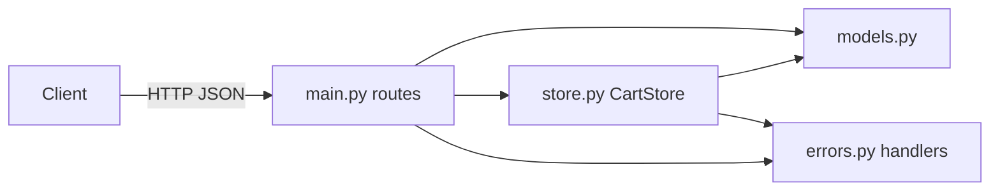
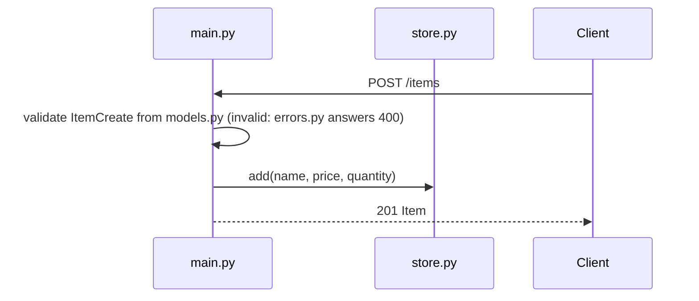

# Architecture
## Context
A small HTTP service holds one in-memory shopping cart. A developer or script adds items, fetches one by id and lists them. Nothing external is called.
## Technology stack
| Concern | Choice | Version | Source |
|---|---|---|---|
| Language | Python | 3.12 | PRD constraints |
| Framework | FastAPI on uvicorn, pydantic v2 models | latest 0.x at creation | PRD constraints |
| Data store | none: in-process list, lost on restart | n/a | PRD constraints |
| Test and tooling | pytest + TestClient (httpx), ruff, mypy, uv | locked in uv.lock | PRD constraints |
## Architecture diagram

```text
Client --HTTP--> main.py --> models.py, store.py, errors.py
                 store.py --> models.py, errors.py
```
## Code structure
```
src/cart/
  main.py     # FastAPI app, routes only, one module-level store (sprint 0)
  models.py   # ItemCreate, Item (sprint 0, planned)
  store.py    # CartStore: add, list_all, get, under a lock (sprint 0, planned)
  errors.py   # error body, 400 and 404 handlers (sprint 0, planned)
tests/        # test_api.py exists; conftest.py and one test_<intent>.py each (sprint 0, planned)
```
## Containers and modules
| Module | Responsibility | Must not |
|---|---|---|
| main.py | routes, wiring | hold business rules |
| models.py | validation, item shape | import store or errors |
| store.py | cart state, ids, locking | know HTTP |
| errors.py | error body and handlers | import store |
## Key flows

```text
1 Client -> main.py: POST /items
2 main.py -> models.py: validate (invalid: errors.py -> 400 validation_error)
3 main.py -> store.py: add(); id drawn and appended under the lock; 201 Item to Client
```
## Data
An Item has id (UUID4 string), name, price (Decimal, at most 2 decimals) and quantity (integer, at least 1), kept in insertion order in memory; the price becomes a JSON number only when serialised.
## Integrations
none: nothing external is called, so no stand-in is needed.
## Quality tactics
| NFR | Target | Tactic | Where | Verified by |
|---|---|---|---|---|
| NFR-1 | 100 concurrent adds leave 100 items, 100 distinct ids | one threading.Lock around id draw and append; reads under it | store.py | unit: tests/test_store.py |
| NFR-2 | 0 errors from ruff and mypy | typed code, lint on every edit | whole repo | uv run ruff check . and uv run mypy . |
## Deployment
`uv run uvicorn cart.main:app --port 8000`, one process (one cart per process).
## Sprint history
| Sprint | Adds | Intents | ADRs |
|---|---|---|---|
| 0 | cart service: add, get, list, error shape | add-item, view-item, list-items | ADR-0001 |
## Decisions
- ADR-0001 item-id-uuid4 (proposed, sprint 0): ids are UUID4 strings, a public id.
- Concurrency: threading.Lock in CartStore; sync routes run in uvicorn's threads (proposed at chart).
- Errors: handler maps RequestValidationError to 400 validation_error, never 422 (proposed at chart).
## Concerns
none
## Open questions
none

## Resolved

- Q1: Leave the framework defaults for unknown paths (404) and wrong methods (405): the PRD lists only validation_error (400) and not_found (404) and forbids unlisted endpoints. (proposed at chart)
