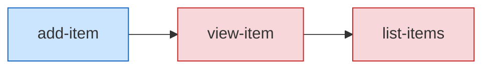

# Sprint 0 plan

<!-- Generated by `chart plan` from the intents' `depends:` lines. Do not edit: change an intent and regenerate. -->

3 intents, 4 engineer-day(s), 3 wave(s). Chart: not approved yet. Intents in the same wave can be built in parallel.

Tasks and the suggested lanes per engineer: [implementation-plan.md](implementation-plan.md). Unassigned: add-item, list-items, view-item (set `owner:` in each intent).

## Waves

| Wave | Intent | Depends on | Days | Owner | Status |
|---|---|---|---|---|---|
| 1 | add-item | - | 2 | - | ready |
| 2 | view-item | add-item | 1 | - | blocked |
| 3 | list-items | view-item | 1 | - | blocked |

## Graph (text)

```text
add-item ○ ready
└─ view-item ✖ blocked
   └─ list-items ✖ blocked
```

Key: ✔ done, ▶ active, ○ ready, ✖ blocked. An arrow-free tree: each intent sits under its latest dependency.

## Graph (Mermaid)



## Next up

- chart-0 is not approved yet: a person runs `/rig:approve chart-0` before anything can start
- `/rig:start add-item`
